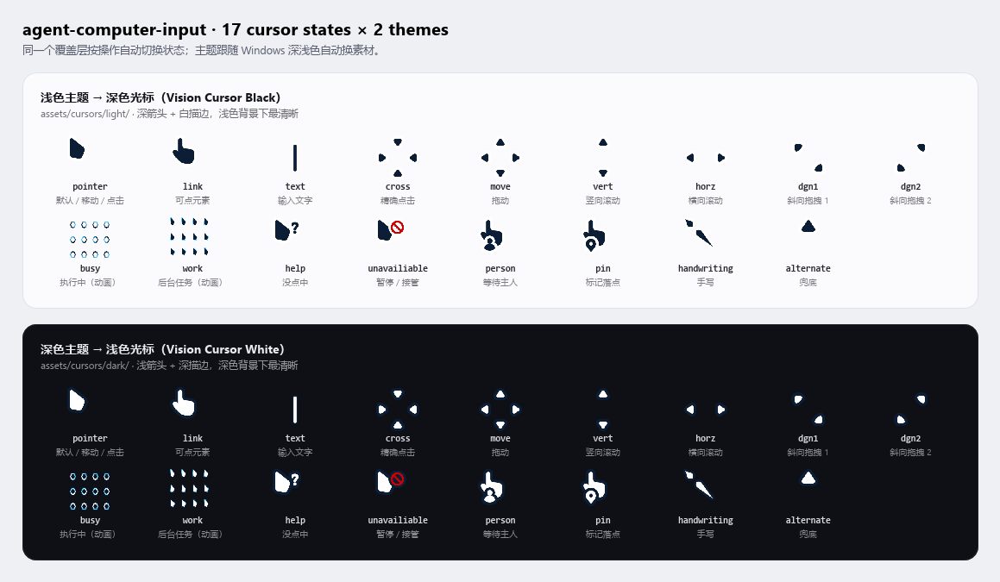

# agent-computer-input

**让你的 Agent 在这台 Windows 上点鼠标、敲键盘——但它永远不碰你的鼠标。**

[](https://modelcontextprotocol.io)
[](#)
[](#)
[](#)
[](#-自测)
[](LICENSE)

所有动作只发到目标窗口 `hwnd`（UIA / 窗口消息），不移动真实光标、不抢键盘焦点；
屏幕上那只置顶的 AI 光标只是一层视觉提示，素材来自 `Cur/` 里的 `.cur` / `.ani` 光标包，
**按 Windows 深浅色自动换**（浅色主题用深色光标，深色主题用浅色光标）。

不是某个 Agent 的插件：同一套动作提供 **MCP / HTTP / CLI / DSH** 四种接入，
Claude Code、Cursor、Codex、ZCode、OpenClaw，或你自己写的脚本，接上就能用。

> Windows 只有一个系统光标和一个键盘焦点，不存在两套真正并行的“系统鼠标”。
> 所以这里的“独立”指的是：**不占用主人那套光标/焦点**，而不是再装一个驱动。



## ✨ 为什么值得用

- **不打扰**：AI 点击/打字走目标 `hwnd` 的 UIA 与窗口消息，你的真实鼠标一像素都不动，
  输入焦点也不会被抢——可以一边让 AI 跑流程，一边自己继续用电脑。
- **看得见**：屏幕上有只置顶、点击穿透、不抢焦点的 AI 光标，按操作自动切换状态
  （移动/输入/可点元素/滚动/拖拽/暂停…），截图里也能看到，方便核对目标。
- **不挑 Agent**：一个 MCP server、一个 HTTP API、一个 CLI；谁都能调，不用为每个宿主写适配。
- **不装驱动**：纯用户态（AutoHotkey 式的注入都没有），没有虚拟 HID、没有签名、没有蓝屏风险。
- **不联网**：不传截图、不回传数据，所有文件都在本机 `~/.agent-computer-input/`。

## 🚀 快速开始

```bash
git clone https://github.com/z416946520/agent-computer-input
cd agent-computer-input
npm test          # 可选：23 个用例，含真实 WinForms 端到端
```

**MCP（推荐）** —— 任何 MCP 客户端：

```jsonc
{
  "mcpServers": {
    "agent-computer-input": {
      "command": "node",
      "args": ["D:/path/to/agent-computer-input/bin/aci-mcp.js"]
    }
  }
}
```

**CLI**：

```bash
node bin/aci.js status                        # 是否暂停、前台窗口、光标主题
node bin/aci.js windows --query chrome        # 拿目标 hwnd
node bin/aci.js click --hwnd 12345 --x 400 --y 300
node bin/aci.js type  --hwnd 12345 --x 400 --y 300 --text "hello" --replace
node bin/aci.js capture --hwnd 12345 --path shot.png
```

**HTTP**（给非 MCP 的 Agent / 自己的脚本）：

```bash
node bin/aci-serve.js                         # http://127.0.0.1:4517
curl -s -X POST localhost:4517/call -H 'content-type: application/json' \
     -d '{"action":"windows","query":"chrome"}'
```

一句话总结用法：`status` → `windows` 拿 `hwnd` → `capture` 拿坐标 → `click`/`type`/`key`/`scroll`/`drag`（必须带 `hwnd`）→ `capture` 复核。

## 🎯 能做什么

| action | 做什么 | 默认通道 |
| --- | --- | --- |
| `status` | 暂停态、主人最近输入、真实光标、前台窗口、AI 光标主题/状态 | 只读 |
| `windows` | 列可见顶层窗口，`query` 可按标题/进程/类名过滤 | 只读 |
| `inspect` | 单个 `hwnd` 的标题/类名/矩形/是否前台 | 只读 |
| `capture` | 截 `hwnd` / `rect` / 全屏，PNG 可随结果返回 | 只读 |
| `click` | 单击 / 双击 / 右键 | UIA → 窗口消息 →（可选）physical |
| `type` | 输入文字（追加或覆盖） | `WM_SETTEXT`（回读校验）→ UIA Value → `WM_CHAR` |
| `key` | 组合键（`ctrl+c`、`alt+tab`、`enter`…） | 目标窗口消息 |
| `scroll` / `drag` | 滚轮 / 拖拽 | 目标窗口消息 |
| `move` / `overlay` | 移动 / 显示 / 隐藏 / 换主题 / 换大小 / 指定状态 | 覆盖层 |
| `pause` / `resume` | 暂停 / 恢复（主人按 `Ctrl+Alt+Q` 也行） | 本地状态 |
| `settings` | 运行时读写设置（任何 Agent 都能改，落盘） | 本地设置 |

`click` / `type` / `key` / `scroll` / `drag` **必须带目标 `hwnd`**——不带就拒绝，
绝不“按坐标碰运气”打到主人正在用的窗口。`physical`（真实鼠标键盘）默认关闭，
需要时显式打开 `allowPhysical`，代价是会动真实光标、切换焦点。

## 🖱 AI 光标：素材、主题与 17 个状态

素材在 `Cur/`：`Vision Cursor Black`（深箭头 + 白描边）给浅色主题，
`Vision Cursor White`（浅箭头 + 深描边）给深色主题。
`npm run build:cursors` 把它们解码成覆盖层能直接画的 PNG：

```
assets/cursors/light/pointer.png    ← 浅色主题用（Vision Cursor Black）
assets/cursors/dark/pointer.png     ← 深色主题用（Vision Cursor White）
assets/cursors/manifest.json        ← 帧数 / 网格 / 热点 / 来源
```

自动识别：读注册表 `HKCU\...\Themes\Personalize\AppsUseLightTheme`，
`1` → 浅色主题 → `light` 目录；`0` → 深色主题 → `dark` 目录。
覆盖层每 **1.5 秒**自查一次，Windows 定时切换主题也会跟着换，**不用重启**；
也可以强制：`node bin/aci.js overlay --cursor-theme dark`。

每个状态都带**热点**（`.cur` 里的 hotspot，按画布等比缩放），窗口位置会减掉热点，
所以箭头尖/十字中心正好落在动作坐标上，而不是“左上角对齐”的近似。

状态按操作自动切换（不用手选）：移动/点击 `pointer`、可点元素 `link`、输入 `text`、
滚动 `vert`/`horz`、拖拽 `move`/`dgn1`/`dgn2`、精确点击 `cross`、执行中 `busy`/`work`（12 帧 `.ani` 动画）、
暂停 `unavailiable`、没点中 `help`、等待主人 `person`、标记落点 `pin`。
任何动作都能强制某个状态：`overlay --cursor-state pin`。

覆盖层用 `UpdateLayeredWindow` + 自建 32bpp 预乘 alpha DIB 绘制：边缘是真实 alpha
（没有色键透明的彩色光晕），点击穿透（`WS_EX_TRANSPARENT`）、不抢焦点（`WS_EX_NOACTIVATE`）。

## 🔌 四种接入

| 接入 | 入口 | 适合 |
| --- | --- | --- |
| MCP stdio | `bin/aci-mcp.js` / `startMcpServer()` | Claude Code、Cursor、Codex、ZCode… |
| HTTP | `bin/aci-serve.js` / `startHttpServer()` | 自家脚本、非 MCP 的 Agent、本地面板 |
| CLI | `bin/aci.js` / `npx aci` | 人肉调试、CI、批处理 |
| DSH 插件 | `src/adapters/dsh/`（`import 'agent-computer-input/dsh'`） | DSH 用户：工具 + 设置页 |

HTTP 端点：`GET /health`、`GET|POST /settings`、`POST /call`、`GET /themes`、
`GET /cursors/:theme/:state.png`。默认只监听 `127.0.0.1`，对外请设 `ACI_HTTP_TOKEN`。

库用法（自己写 Agent）：

```js
import { createInputRunner, loadSettings } from 'agent-computer-input'

const { settings } = loadSettings({})
const runner = createInputRunner({ settings })
const out = await runner.runAction({ action: 'windows', query: 'chrome' })
console.log(out.text, out.meta)
await runner.dispose()
```

## 🧠 工作原理

```
Agent ──MCP / HTTP / CLI / DSH──▶ 动作层 src/core/actions.js
                                        │ 目标 hwnd + 参数
                                        ▼
                            sidecar.ps1（常驻 PowerShell 5.1 STA）
                            ├─ UIA：Invoke / Toggle / Select / Value
                            ├─ 窗口消息：WM_LBUTTONDOWN、WM_SETTEXT、WM_CHAR、WM_MOUSEWHEEL…
                            ├─ 截图：CopyFromScreen（截图前临时收起覆盖层）
                            ├─ 暂停热键：RegisterHotKey（默认 Ctrl+Alt+Q）
                            └─ 覆盖层：UpdateLayeredWindow 逐像素 alpha
                                  └─ assets/cursors/{light,dark}/*.png ← Cur/*.cur 烘焙
```

sidecar 第一次调用工具时才启动（`Add-Type` 现场编译 C#，约 1–3 秒），之后常驻复用；
长时间没人用它就自己退出（`idleShutdownMs`），下次调用再起来。协议是带版本号的 JSON 行，
崩溃自动重拉、写管道串行、请求可并发。

## ⚙️ 配置

优先级：显式参数 > 环境变量 > `~/.agent-computer-input/settings.json` > 默认值。

| 键 | 默认 | 说明 |
| --- | --- | --- |
| `enabled` | `true` | 总开关，关掉后任何动作都不执行 |
| `cursorMode` | `companion` | `companion` 一直显示 / `clean` 动作后收起 |
| `cursorHoldMs` | `2600` | clean 模式停留毫秒 |
| `cursorSize` | `96` | 覆盖层边长（24–192） |
| `cursorTheme` | `auto` | `auto` / `light` / `dark` |
| `cursorOpacity` | `1` | 0.2–1（只作用于光标像素） |
| `animations` | `true` | 是否播放 `work`/`busy` 动画 |
| `hotkey` | `Ctrl+Alt+Q` | 暂停热键，空串 = 不注册 |
| `allowPhysical` | `false` | 是否允许真实鼠标/键盘 |
| `idleShutdownMs` | `600000` | 空闲多久回收 sidecar（覆盖层显示中不回收） |
| `shotsDir` | `null` | 截图目录，默认 `~/.agent-computer-input/shots` |

环境变量加 `ACI_` 前缀：`ACI_CURSOR_THEME=dark`、`ACI_ALLOW_PHYSICAL=1`、
`ACI_HOME=<dir>`、`ACI_POWERSHELL=<path>`…

## 🧪 自测

```bash
npm test                                    # 全部（23 个）
node --test test/cur.test.mjs test/cursor-assets.test.mjs   # 只跑解码/素材
node --test test/e2e.test.mjs                               # 端到端（会弹测试窗口）
```

端到端覆盖：窗口消息点击真的点到按钮、UIA 点击、`WM_SETTEXT` 写入并回读、
AI 光标置顶/点击穿透/不抢焦点、热点偏移等比缩放、clean 模式自动收起、
截图是合法 PNG、暂停后拒绝动作、`physical` 默认禁用、MCP 与 HTTP 协议实跑。

## 📁 目录结构

```
bin/aci.js                    CLI 入口
bin/aci-mcp.js                MCP stdio 入口
bin/aci-serve.js              HTTP 入口
index.js                      库入口（createInputRunner / loadSettings …）
src/core/cur.js               .cur/.ico/.ani 解码 + PNG 编解码（零依赖）
src/core/cursor-build.js      素材烘焙：Cur → assets/cursors/{light,dark} + manifest + 预览图
src/core/theme.js             Windows 深浅色探测
src/core/settings.js          设置读写 / 夹取 / 环境变量覆盖
src/core/sidecar.js           sidecar 客户端：懒启动、协议 v2、超时、重启、空闲回收
src/core/actions.js           动作层：参数 → sidecar 命令 → 人话结果
src/core/tool-spec.js         唯一一份工具 schema（MCP/DSH/文档共用）
src/server/{mcp,http,cli}.js  MCP server / HTTP API / CLI
src/adapters/dsh/             DSH 插件 + 设置页 UI（可选，可整目录删除）
src/sidecar/sidecar.ps1       P/Invoke + UIA + 窗口消息 + 钩子 + 分层覆盖层
assets/cursors/               烘焙产物（light / dark / manifest.json / preview）
Cur/                          光标素材包原始文件（Vision Cursor Black / White）
docs/preview.html,preview.png README 用的状态预览（moli 截图）
test/                         node:test 单测 + WinForms 端到端
```

## ⚠️ 限制

- UIA 对现代控件（Chromium、WPF、UWP、WinUI）通常可用；老 WinForms / 原生控件可能只有 MSAA，
  这时落到窗口消息或 `WM_SETTEXT`。
- 少数应用忽略 `PostMessage` 的鼠标/键盘消息（游戏、部分 Chromium 输入框），
  这种情况只能开 `allowPhysical`，代价是真实光标会动、焦点会切。
- 管理员权限窗口无法被非管理员进程点击/输入（系统限制）。
- 没有驱动、没有虚拟 HID、没有第二套系统光标——有意的，避免驱动签名和蓝屏风险。
- 只有 Windows 实现；macOS/Linux 需要另写 sidecar（动作层与接入层可直接复用）。

## 🙏 Credits / 致谢

**整体设计与 Windows 侧实现源自 [dongcaodeliyu/dsh-independent-input](https://github.com/dongcaodeliyu/dsh-independent-input)**
（MIT，© 2026 冬草里的鱼）。

- 原仓库路径：<https://github.com/dongcaodeliyu/dsh-independent-input>
- 它提供了这套东西的底子：「只向目标 hwnd 发 UIA / 窗口消息、不碰真实光标不抢焦点」的设计取向、
  sidecar（PowerShell 5.1 STA + 内联 C# P/Invoke）结构、`Ctrl+Alt+Q` 暂停热键与安全边界、15 个光标状态的自动化思路。
- 感谢作者把这么完整的一套方案开源，这个项目是在它肩膀上的重构，不是从零开始的发明。

本仓库相对原仓库的改动：改名与分层（核心 / 接入 / 适配三层，MCP + HTTP + CLI + DSH 四路）、
`.cur/.ani` 解码与光标素材替换（主题自动适配）、`UpdateLayeredWindow` 逐像素 alpha 覆盖层、
热点等比定位、协议 v2（版本握手 / 空闲回收 / 崩溃重拉）、跨进程控件文本读取修复（原实现会写两遍文字）。

**光标美术**：*Vision Cursor White / Black* by **Darques**，第三方免费素材，非本项目原创，
不按 MIT 再授权；详见 [NOTICE](NOTICE)。

## 📄 License

代码 MIT，见 [LICENSE](LICENSE)。光标素材版权归原作者（Darques），见 [NOTICE](NOTICE)。
